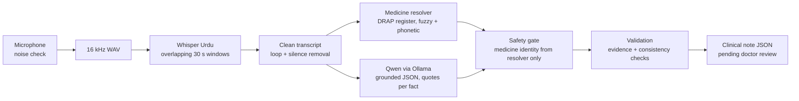

# Doctors Appointment Transcriber

Turns a doctor–patient consultation spoken in **Urdu or mixed Urdu-English** into a structured clinical note (complaints, history, findings, medicines with doses, advice), ready for the doctor to review and sign off.

It is built around one rule: **the model may only write down what was actually said.** Nothing is diagnosed, inferred or "completed" from medical knowledge. Every fact in the note carries the transcript quote it came from, and anything the system cannot ground is flagged for the doctor instead of guessed.

> Status: working prototype and evaluation project. It has not been clinically validated and is not a medical device. All output is a draft for a clinician to review.

## Why

Doctors in Pakistan consult in Urdu, English and everything in between, often switching mid-sentence, with Pakistani accents and local brand names for medicines. Off-the-shelf dictation tools handle none of that well, and a general LLM asked to "write the note" will happily invent symptoms, diagnoses and drug names that were never spoken. This project tackles both problems: speech recognition tuned for Urdu, and an extraction step that is boxed in by code, not just by a prompt.

## Two versions in this repo

| | Local (`doctor_assistant/`) | Web app (`web/` + `openai_trial/`) |
|---|---|---|
| Speech-to-text | Whisper large-v3, Urdu fine-tune, on your GPU | OpenAI transcription API |
| Note extraction | Qwen (8–9B) through Ollama, on your GPU | OpenAI model with a strict JSON schema |
| Medicines | Matched against the DRAP drug register (Pakistan) | Taken from the transcript, flagged for review |
| Interface | Terminal | Browser: consultation workflow, live recording, review, print |
| Data leaves the PC | Never | Audio and transcript go to OpenAI |

## How the local pipeline works



1. **Recording** (`audio.py`): calibrates ambient noise, records until you press Enter, resamples to 16 kHz.
2. **Transcription** (`transcription.py`): long consultations are split into overlapping windows under Whisper's 30-second limit and stitched back without duplicating the overlap. Repetition loops Whisper produces during silence are removed. Whisper runs in its own process so its GPU memory is fully released before the LLM loads.
3. **Medicines** (`medicines.py`): candidate drug names are taken only from phrases next to a dose or instruction, then matched against the DRAP register using a combined fuzzy, phonetic and consonant-skeleton score built for Urdu spellings of brand names. A match is accepted only if it is both confident and unique; otherwise the medicine stays "unresolved" with the doctor's own words.
4. **Extraction** (`extraction.py`): Qwen fills a fixed JSON schema and must cite a transcript span ID for every fact. Its output is parsed strictly; partial or malformed JSON is rejected, never repaired.
5. **Safety gate**: the model is not allowed to name a medicine. Drug identities come only from the resolver in step 3, so a hallucinated brand can't reach the note.
6. **Validation** (`validation.py`): checks that each cited quote really appears in the transcript, and runs deterministic consistency checks on doses, frequencies, blood pressure readings and similar values. Problems become review flags on the note.

## The web app

A local browser app for the full consultation flow: new consultation → patient and consent → record live or upload → generate the note → edit any field → confirm as reviewed → print a clean report (AI-only content is excluded from the printout).

- Live audio is captured with an AudioWorklet and saved in 250 ms blocks to IndexedDB before upload, so a dropped connection loses nothing and retries never duplicate a paid transcription.
- Consultations, revisions and API costs are stored in local SQLite; every save checks the record revision to prevent stale-tab overwrites.
- It binds to `127.0.0.1` only. See [`web/README.md`](web/README.md) for details.

## Run it

**Local pipeline** (Windows, NVIDIA GPU recommended; tested on an RTX 5080 16 GB):

```powershell
python -m venv .venv
.\.venv\Scripts\pip install -r requirements.txt
ollama pull <a Qwen 8-9B instruct model>      # then set OLLAMA_MODEL to its name
python drap_crawler.py                          # builds drap_master.db from the public DRAP register (one-off, slow)
$env:OLLAMA_MODEL = "<model name from ollama list>"
python test.py                                  # records a consultation, prints and saves the note
```

Set `AUDIO_FILE` to a `.wav` path to process an existing recording instead of the microphone. `WHISPER_MODEL` and `OLLAMA_URL` can be overridden the same way.

**Web app:** set up `openai_trial` (see [`openai_trial/README.md`](openai_trial/README.md)) with your own `OPENAI_API_KEY`, then from `web/` run `npm install` and `./start-local.ps1`.

**Tests:**

```powershell
python -m unittest discover tests
python web/backend/test_flow.py
python web/backend/test_streaming.py
```

## What is not in this repo

- Recordings, generated notes and the consultation database: they never leave the machine.
- `drap_master.db` (about 4 GB): rebuild it with `drap_crawler.py`.
- The fuzzy-index cache files: rebuilt automatically on first run.
- API keys: read from the environment at runtime.

## Known limits

- Accuracy depends heavily on the microphone and room; crosstalk and heavy code-switching still cause transcription errors.
- Urdu medicine names that Whisper spells very differently from the register stay unresolved (by design, rather than guessed).
- No authentication, encryption at rest or hospital system integration: this is a single-computer prototype.

## Repository layout

```
doctor_assistant/   local pipeline (audio, transcription, medicines, extraction, validation)
tests/              unit tests for the local pipeline
web/                browser app (Next.js front end, Python back end)
openai_trial/       OpenAI-based transcription and structured-note service used by the web app
experiments/        earlier single-file versions and the original prompt, kept for reference
drap_crawler.py     builds the DRAP medicine database
medicines_pk.csv    small seed list of common Pakistani medicines
```

## License

MIT
